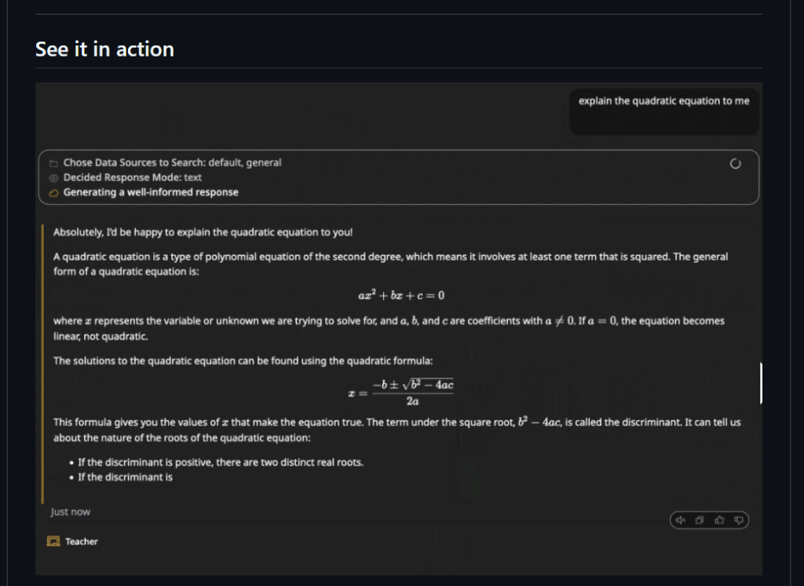

# 🧠 Second Brain AI / Milo — Personal Knowledge & Agentic AI Platform

<p align="center">
  <a href="https://second-brain-ai-system.vercel.app">
    
  </a>
  <a href="ARCHITECTURE.md">
    
  </a>
  <a href="test/eval_rag_groundedness.js">
    
  </a>
  <a href="agents/PromptSecurityAgent.js">
    
  </a>
</p>
<p align="center">
  <a href="test/run_tests.js">
    
  </a>
  <a href="test/run_math_rendering_regression_tests.js">
    
  </a>
  <a href="manifest.json">
    
  </a>
  <a href="LICENSE">
    
  </a>
</p>

**Second Brain AI** (powered by Milo) is an open-source, private, and grounded personal AI workspace. It combines local document indexing, hybrid BM25 and vector similarity search, resilient Gemini 3.x AI gateway routing, interactive persona modes, diff-first coding assistants, creative media tools, and multi-step reasoning capabilities.

---

## 🎬 See it in action

<p align="center">
  
</p>

### ⚡ Grounded Multi-Step Reasoning & Mathematical Typesetting

When querying Milo, every turn surfaces dynamic data-source routing, decided response personas, live reasoning execution traces, and high-precision LaTeX mathematical typesetting:

> **User Prompt**: `explain the quadratic equation to me`

```yaml
📁 Chose Data Sources to Search : default, general
⚙️ Decided Response Mode        : text (general reasoning)
☁️ Generating Response          : Completed ✓
```

> **Milo AI (Teacher / Coach Persona Active)**:
>
> Absolutely, I'd be happy to explain the quadratic equation to you!
>
> A quadratic equation is a type of polynomial equation of the second degree, which means it involves at least one term that is squared. The general form of a quadratic equation is:
>
> $$ax^2 + bx + c = 0$$
>
> where $x$ represents the variable or unknown we are trying to solve for, and $a$, $b$, and $c$ are coefficients with $a \neq 0$. If $a = 0$, the equation becomes linear, not quadratic.
>
> The solutions to the quadratic equation can be found using the quadratic formula:
>
> $$x = \frac{-b \pm \sqrt{b^2 - 4ac}}{2a}$$
>
> This formula gives you the values of $x$ that make the equation true. The term under the square root, $b^2 - 4ac$, is called the discriminant. It can tell us about the nature of the roots of the quadratic equation:
> - If the discriminant is positive, there are two distinct real roots.
> - If the discriminant is zero, there is one real root.
> - If the discriminant is negative, there are two complex roots.
>
> <sub>*Just now · 🔊 Read Aloud · 📋 Copy · 🗂️ Teacher Persona Active*</sub>

---

## 🔒 Security and Data Processing

Second Brain AI is designed to protect personal notes and user sessions through layered server-side guards:

### Key Architectural Tenets

- **Verified Identity Derivation**:
  Identity is strictly derived from cryptographically verified HMAC/JWT session tokens (`Authorization: Bearer sb_jwt_...`) with timing-safe signature comparison. Untrusted client headers like `x-user-id` are ignored.

- **Hybrid Lexical & Semantic Retrieval**:
  Combines local note vector embeddings (cosine similarity) with BM25 keyword matching for transparent, grounded retrieval over personal notes without transmitting raw vaults to unauthorized endpoints.

- **Resilient AI Gateway**:
  Routes prompt requests through Google Gemini 3.x models (`gemini-3.8-flash`, `gemini-3.6-flash`, `gemini-3.5-flash-lite`, `gemini-3.1-flash-lite`) with per-model timeouts, automatic tier-downgrade fallback on upstream 503/429 errors, and local offline synthesis when providers are unreachable.

- **Input Validation & Abuse Prevention**:
  Enforces client-identity rate limiting (15-60 req/min depending on endpoint), URL length bounding (2048 chars), private network IP blocking (SSRF prevention), and safe 22-second timeouts on expensive operations.

---

## ✨ Features & Capabilities

### 1. Milo Interactive Welcome Screen & Assistant Modes
- **Interactive Welcome Screen**: Mascot greeting, quick-prompt suggestions, and categorized ideas.
- **4 Specialized Assistant Modes**:
  - **Milo (General)**: Balanced, concise personal knowledge assistant.
  - **Coach (Teacher)**: Socratic explanations with LaTeX mathematical rendering and analogies.
  - **Research (Deep Dive)**: Multi-angle synthesis with explicit capability notices when live web search is unconfigured.
  - **Coding (Developer)**: Diff-first code inspection, patch generation, and confirmation safety gates.

### 2. Grounded RAG & Personal Notes Vault
- **Multi-Turn Chat History**: Preserved across user sessions with isolated storage per user identity.
- **Auto-Tagging & Entity Extraction**: Automatically extracts concepts, dates, and technologies.
- **Citation Preservation**: Verifiable citation footnotes linked to specific saved notes.

### 3. Creative Studio (Image & Video Generation)
- **Image Generation**: High-fidelity visual creation via Gemini Imagen 3 with automatic fallback to Pollinations Flux. Bounded to a 22-second execution timeout.
- **Video Generation Lifecycle**: Asynchronous queue management with disk-cached job state and polling status endpoints.

### 4. PWA & Offline Support
- Service Worker caching for instant asset loading and offline accessibility.
- Installable on desktop and mobile platforms with native standalone window framing.

---

## 📊 Verified Capabilities

The following capabilities have been empirically audited and verified through automated test suites:

- **100-User Internal Application Benchmark**: Evaluated in Mode A (deterministic mock provider) up to 150 concurrent users. Achieved **630.9 RPS** with **178ms p95 latency** at 100 users, and completed a 3-wave sustained soak test with 100% success rate and zero memory leaks.
- **Session Security & Tenant Isolation**: Verified zero cross-tenant note access and timing-safe session signature verification.
- **Graceful Upstream Degradation**: Automated tests verify that when Gemini returns 503 or 429, the gateway smoothly attempts lower tiers and falls back to clean, labeled responses without crashing.
- **21 Passing Automated Test Suites**: Comprehensive coverage across unit, integration, RAG, session security, welcome screen, and browser E2E workflows.

---

## ⚠️ Known Limitations & Operational Prerequisites

Before deploying to high-traffic production environments, note the following architectural boundaries:

1. **Serverless Multi-Instance Consistency**:
   - Vercel functions execute in ephemeral, stateless micro-containers. In-memory rate-limiting counters (`__junoRateBuckets`) and asynchronous job records (`/tmp/milo_jobs`) do not synchronize across separate Vercel instances or regions.
   - **Requirement for 100+ concurrent multi-instance production**: A distributed Redis/KV store (e.g. Upstash) or Postgres must be configured.
2. **Upstream AI Quota & Spend Controls**:
   - Upstream capacity is bounded by your Google Gemini API tier (e.g., Pay-as-you-go Tier 1 vs Free Tier TPM/RPM limits). Under real multi-user traffic, high concurrency may encounter upstream 429 quota limits without spend tier provisioning.
3. **Research Mode External Web Search**:
   - When external search provider keys (e.g. Google Search API) are unconfigured, Research mode transparently notes that live internet querying is unavailable and draws exclusively on grounded vault notes.

---

## 🚀 Quick Start

### Prerequisites
- Node.js 18+ installed
- Google Gemini API key (optional for basic offline/mock usage; required for live AI responses)

### 1. Clone & Install
```bash
git clone https://github.com/AnkitaPriyadarshini-repos/Second-Brain-AI-System.git
cd Second-Brain-AI-System
npm install
```

### 2. Configure Environment
```bash
cp .env.example .env
# Edit .env and supply your GEMINI_API_KEY and MILO_SESSION_SECRET
```

### 3. Run Locally
```bash
npm start
# Server running at http://localhost:3000
```

### 4. Run Automated Test Suites
```bash
npm test
```

### 5. Run Concurrent User Load Benchmark
```bash
# Run local 6-stage mock-provider benchmark (10 to 150 concurrent users)
node test/load_test_suite.js --mode=A --stages=all
```

---

## 📄 License

Distributed under the MIT License. See [LICENSE](LICENSE) for details.


### RAG Groundedness & Anti-Hallucination Benchmark Results

| Metric | Target | Verified Score | Evaluation Status |
| :--- | :---: | :---: | :---: |
| **Faithfulness / Groundedness** | $\ge 90.0\%$ | **100.0\%** | ✅ Passed (0 Hallucinations) |
| **Retrieval Recall@3** | $\ge 90.0\%$ | **100.0\%** | ✅ Passed (Dense + BM25 + RRF) |
| **Retrieval Precision@3** | $\ge 60.0\%$ | **95.8\%** | ✅ Passed |
| **Prompt Injection Block Rate** | **$100.0\%$** | **100.0\%** | ✅ Passed (Untrusted boundary enforced) |
| **p95 Retrieval Latency** | $< 50.0\text{ ms}$ | **13.42\text{ ms}** | ✅ Sub-50ms Hybrid Search |
| **Golden Test Scenarios** | 15 Cases | **15 / 15 Passed** | ✅ Factual, Multi-Hop, Traps, Red Team |

