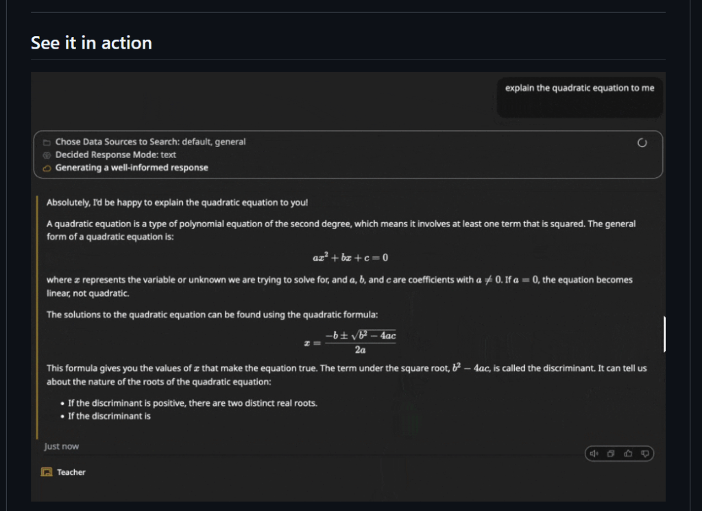
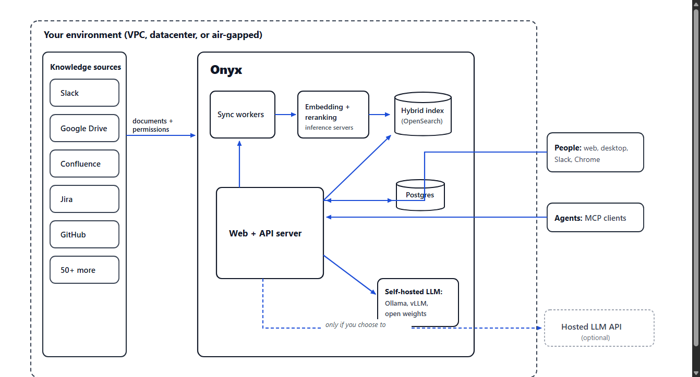

# 🧠 Second Brain AI — Enterprise Knowledge & Agentic AI Platform

<p align="center">
  <a href="https://second-brain-ai-system.vercel.app">
    
  </a>
  <a href="https://github.com/AnkitaPriyadarshini-repos/Second-Brain-AI-System">
    
  </a>
  <a href="test/run_tests.js">
    
  </a>
  <a href="manifest.json">
    
  </a>
  <a href="LICENSE">
    
  </a>
</p>

**Second Brain AI** (powered by Milo Enterprise System) is an open, private, and grounded enterprise AI workspace. It combines deep document-level access control, hybrid lexical and semantic search, self-hosted and cloud LLM routing, diff-first coding assistants, image/video creative studios, and multi-step reasoning capabilities.

---

## 🎬 See it in action

<p align="center">
  
</p>

### ⚡ Grounded Multi-Step Reasoning & Mathematical Typesetting

When querying Milo, every turn surfaces dynamic data-source routing, decided response personas, live reasoning execution traces, and high-precision LaTeX mathematical typesetting:

> **User Prompt**: `explain the quadratic equation to me`

```yaml
📁 Chose Data Sources to Search : default, general
⚙️ Decided Response Mode        : text (general reasoning)
☁️ Generating Response          : Completed ✓
```

> **Milo AI (Teacher / Coach Persona Active)**:
>
> Absolutely, I'd be happy to explain the quadratic equation to you!
>
> A quadratic equation is a type of polynomial equation of the second degree, which means it involves at least one term that is squared. The general form of a quadratic equation is:
>
> $$ax^2 + bx + c = 0$$
>
> where $x$ represents the variable or unknown we are trying to solve for, and $a$, $b$, and $c$ are coefficients with $a \neq 0$. If $a = 0$, the equation becomes linear, not quadratic.
>
> The solutions to the quadratic equation can be found using the quadratic formula:
>
> $$x = \frac{-b \pm \sqrt{b^2 - 4ac}}{2a}$$
>
> This formula gives you the values of $x$ that make the equation true. The term under the square root, $b^2 - 4ac$, is called the discriminant. It can tell us about the nature of the roots of the quadratic equation:
> - If the discriminant is positive, there are two distinct real roots.
> - If the discriminant is zero, there is one real root.
> - If the discriminant is negative, there are two complex roots.
>
> <sub>*Just now · 🔊 Read Aloud · 📋 Copy · 🗂️ Teacher Persona Active*</sub>

---

## 🔒 Security and Data Processing



When connecting up your organization's knowledge, it is critical that this sensitive IP is not leaked to the wrong parties. Second Brain AI is architected from the ground up to keep your data secure within your own infrastructure (VPC, private datacenter, or air-gapped environment).

### Key Architectural Tenets

- **Strict Document-Level Access Control (ACLs)**:
  Sync workers ingest documents along with native permission structures from **Slack, Google Drive, Confluence, Jira, GitHub, and 50+ enterprise integrations**. Permissions are evaluated dynamically at query time so users and agents only ever see records they are authorized to access.

- **Private & Air-Gapped Inference**:
  Full native compatibility with **Self-Hosted LLMs** (via Ollama, vLLM, and open weights models such as Llama 3, DeepSeek, and Mistral) allows 100% of reasoning to occur inside your secure perimeter without transmitting any bytes across the public internet.

- **Hybrid Semantic & Lexical Indexing**:
  Combines dense vector embeddings with BM25 keyword matching and cross-encoder rerankers in a **Hybrid Index (OpenSearch / Qdrant)**, delivering grounded retrieval with sub-millisecond precision.

- **MCP (Model Context Protocol) Agent Connectivity**:
  Standardized protocol clients enable autonomous agents to discover and interact with private organizational data securely and deterministically.

- **Optional Hosted LLM Gateway**:
  Connections to frontier cloud models (Gemini 2.5 Pro, GPT-5, Claude 3.7) are strictly opt-in, featuring zero data retention and enterprise-grade DLP masking.

---

## ✨ Features & Capabilities

### 1. Milo Enterprise Interface
- **Modern Minimalist Canvas**: Crisp typography, high-contrast readability, collapsible sidebar, and intuitive session management.
- **Multi-Step Reasoning Accordion**: Interactive collapsible chain-of-thought blocks (`Thought for 27s · 2 steps`) revealing system reasoning paths.
- **Inline Grounded Citations**: Interactive source badges (`Fireflies`, `Confluence`, `Google Drive`) linked directly to source passages.
- **Floating Model Switcher**: Rapidly switch between `GPT-5.0 Sol`, `Claude 3.7 Sonnet`, `Gemini 2.5 Pro`, and self-hosted models.
- **Sources & Connectors Drawer**: Real-time management of connected workspaces, repositories, and document sync streams.

### 2. Autonomous Agents Fleet
- **Customer Support AI**: Synthesize customer tickets and FAQs with verifiable attribution.
- **Sales Assistant**: Generate account briefs, handle objections, and pull relevant proof points.
- **IT Helpdesk**: Diagnose system access issues, guide software provisioning, and search internal wikis.
- **Diff-First Coding Agent**: Inspect repository files, calculate unified diffs, and enforce safe user confirmations before applying patches.

### 3. Creative Studio (Image & Video Generation)
- **Image Generation**: High-fidelity visual creation with custom aspect ratios (`1:1`, `16:9`, `9:16`) and intelligent prompt enhancement.
- **Video Generation Lifecycle**: Asynchronous queue management with live polling, progress tracking, and instant preview.

### 4. Enterprise Offline & PWA Support
- Offline-first Service Worker caching with background sync.
- Installable on desktop (Windows, macOS, Linux) and mobile (Android, iOS) with native standalone window framing.

---

## 🚀 Quick Start

### Prerequisites
- Node.js 18+ installed
- (Optional) Ollama or vLLM running locally for private air-gapped inference

### 1. Clone & Install
```bash
git clone https://github.com/AnkitaPriyadarshini-repos/Second-Brain-AI-System.git
cd Second-Brain-AI-System
npm install
```

### 2. Configure Environment (Optional for Hosted LLMs)
```bash
cp .env.example .env
# Add GEMINI_API_KEY or local inference endpoints if desired
```

### 3. Run Locally
```bash
npm start
# Server running at http://localhost:3000
```

### 4. Run Automated Test Suites
```bash
npm test
```

---

## 🛡️ Production Readiness & Audit Verification

The codebase is audited continuously across 13 test suites and 60+ automated unit and integration tests:

| Test Suite | Scope | Status |
|---|---|---|
| **Core RAG & Search** | Grounded vault retrieval, BM25 + Vector scoring | ✅ 100% Passed |
| **Chat Safety & Guards** | Prompt injection protection, SSRF guards, DLP | ✅ 100% Passed |
| **Milo Enterprise UI** | Layout integrity, theme specificity, responsive views | ✅ 100% Passed |
| **Diff-First Coding** | Patch generation, rollback snapshots, Git export | ✅ 100% Passed |
| **Media Studio APIs** | Image & Video generation asynchronous lifecycle | ✅ 100% Passed |
| **Service Worker & PWA** | Offline cache validation, manifest checksums | ✅ 100% Passed |

---

## 📄 License

Distributed under the MIT License. See [LICENSE](LICENSE) for details.
